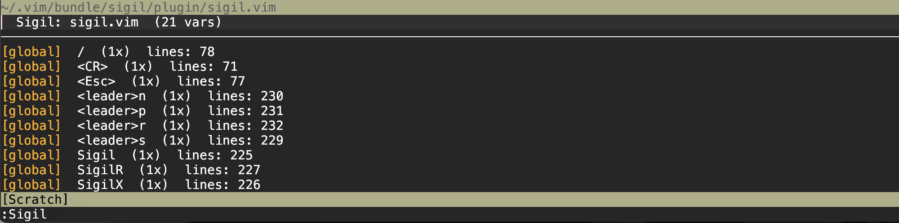
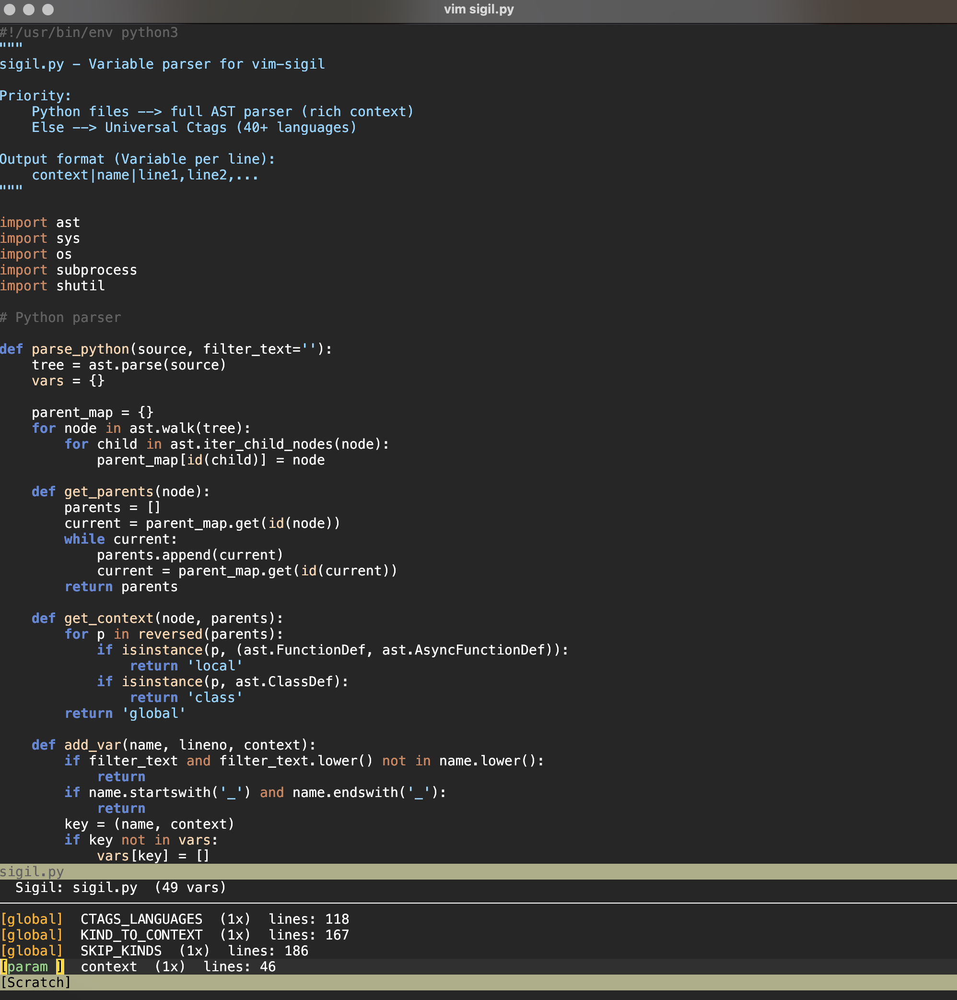

# Sigil
## Overview
A clean little vim plugin that scans the active file and lists every variable in a separate panel.
<p align="center"></p>
<p align="center"></p>

- **Display Scope**: Line numbers variables occur
- **Features**: Jump, cycle, filter, rename, and supports 40+ languages currently.
- **Python** — full AST parser, rich context (`global`, `local`, `param`, `loop`, `comp`, `except`)
- **Everything else** — [Universal Ctags](https://ctags.io), covering C, C++, Go, Rust, Java, JavaScript, TypeScript, Ruby, PHP, Kotlin, R, Julia, SQL, Bash, and more

## Requirements
- [vim] (obviously)
- [Python 3.8+]
- [Universal Ctags](https://ctags.io) (for non-Python files)

```sh
brew install universal-ctags          # macOS
sudo apt install universal-ctags      # Debian / Ubuntu
sudo dnf install ctags                # Fedora
```

## Installation
<details>
<summary><b>Vim-Plug</b></summary>

#### Github 
```vim
Plug 'zblauser/sigil'
```
#### Local
```vim
Plug '~/.vim/plugged/sigil'
```
</details>

<details>
<summary><b>Manual</b></summary>

#### Move Directory
```bash
mv -r /sigil ~/.vim/bundle/sigil
```

#### Edit .vimrc
```vim
set runtimepath+=~/.vim/bundle/sigil
```
</details>

Update anytime with `:PlugUpdate sigil`.

## Configuration

```vim
let g:sigil_height = 15      " panel height (default: 12)
let g:sigil_python = 'python3'
```
## Usage

| Key / Command  | Action |
|----------------|--------|
| `<leader>s`    | Open / refresh panel |
| `<leader>n`    | Next occurrence of word under cursor |
| `<leader>p`    | Previous occurrence |
| `<leader>r`    | Rename word under cursor |
| `:Sigil`       | Open panel |
| `:SigilX`     | Close panel |
| `:SigilR` 	 | Rename under cursor |

**Inside the panel:**

| Key       | Action |
|-----------|--------|
| `Enter`   | Jump to first occurrence, close panel |
| `o`       | Jump, keep panel open |
| `n` / `p` | Cycle occurrences |
| `r`       | Rename selected variable |
| `/`       | Filter |
| `Esc`     | Clear filter |
| `q`       | Close |

## Contributing
If you share the belief that simplicity empowers creativity, feel free to contribute.

#### Contribution is welcome in the form of:
- Forking this repo
- Submitting a Pull Request
- Bug reports and feature requests
Ensure your code follows the existing style.

## Thank you for your attention.
This project started out as self-solving a specific need, and evolved into something I think could actually be useful. If you hit any issues, feel free to open one. Pull requests, suggestions, and fixes I don't have to make myself are welcome. Complaints go to /dev/null.
